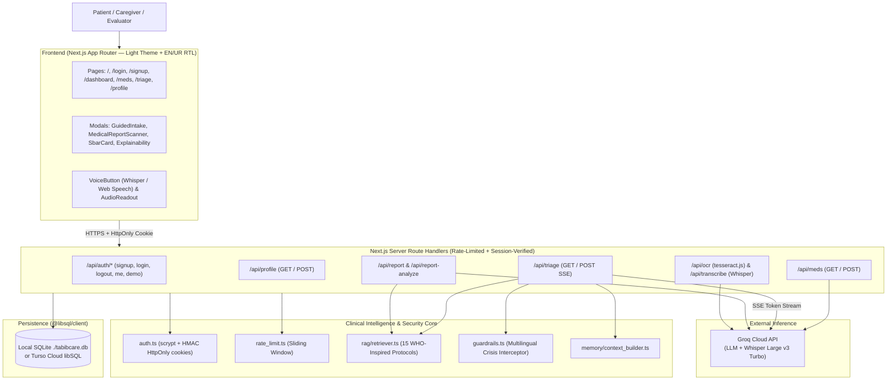

# TabeebCare (طبیب کیئر) — AI for Accessible Healthcare & Well-Being

[](https://tabeeb-care.vercel.app)
[](https://sdgs.un.org/goals/goal3)
[](https://nextjs.org/)
[](https://groq.com/)
[](https://turso.tech/)
[](./LICENSE)

> **Seekers Tech & Computing Society (STCS) • Student Week 2026**  
> **Minhaj University Lahore • AI Hackathon & Startup Pitch**  
> Challenge Track: **United Nations SDG 3 — Good Health and Well-Being**  
> Official Repository: [https://github.com/muhammadali382/SDG_03](https://github.com/muhammadali382/SDG_03)  
> Live Deployment Target: [https://tabeeb-care.vercel.app](https://tabeeb-care.vercel.app)

---

## Table of Contents
1. [Project Overview](#1-project-overview)
2. [Problem Statement](#2-problem-statement)
3. [Key Features](#3-key-features)
4. [Technology Stack](#4-technology-stack)
5. [System Architecture](#5-system-architecture)
6. [Project Structure](#6-project-structure)
7. [Installation and Setup](#7-installation-and-setup)
8. [Environment Variables](#8-environment-variables)
9. [API Documentation](#9-api-documentation)
10. [AI Agent Architecture & Safety Guardrails](#10-ai-agent-architecture--safety-guardrails)
11. [60-Second Evaluation Walkthrough](#11-60-second-evaluation-walkthrough)
12. [Security and Medical Disclaimer](#12-security-and-medical-disclaimer)
13. [Current Limitations & Future Roadmap](#13-current-limitations--future-roadmap)
14. [Contributing](#14-contributing)
15. [License and Acknowledgements](#15-license-and-acknowledgements)

---

## 1. Project Overview

**TabeebCare** is an AI health literacy, prescription demystifier, and clinical symptom triage platform built in alignment with **United Nations Sustainable Development Goal 3 (Good Health and Well-Being)**.

The application translates complex prescriptions and lab reports into plain **English**, stratifies acute symptoms into clinical urgency tiers grounded in 15 WHO-inspired primary care protocols, supports voice input and audio readout, provides a searchable consultation & medication history (`/history`) and clinical protocols library (`/protocols`), and synthesizes multi-question patient intake into structured **SBAR** doctor handover reports.

### Intended Users
- **Patients & Families**: Outpatients managing multi-drug prescriptions, lab results, chronic conditions (Diabetes, Hypertension), or acute symptoms.
- **Caregivers**: Family members coordinating dosing schedules and red-flag monitoring for elderly dependents.
- **Primary Care Physicians**: Doctors receiving concise, structured SBAR handover summaries during brief outpatient visits.

---

## 2. Problem Statement

TabeebCare addresses four everyday barriers in accessible primary healthcare:

1. **Prescription Misunderstanding & Medication Non-Adherence**: Patients often struggle to decipher medical prescriptions, distinguish brand names from generic compounds, or follow timing and meal instructions.
2. **Allergy & Contraindication Blind Spots**: Known drug allergies (e.g., Penicillin, Sulfa) and chronic conditions are frequently overlooked during rushed dispensing.
3. **Emergency Triage Uncertainty**: Patients struggle to distinguish self-limiting minor illness from life-threatening red flags (cardiac ischemia, stroke FAST signs, severe dehydration), delaying critical emergency care or crowding emergency rooms.
4. **The Short Consultation Gap**: Brief outpatient appointments leave little time to recount full symptom timelines and medical histories clearly.

---

## 3. Key Features

### Medicine Demystifier & Prescription OCR (`/meds`)
- **Text, Voice, or Photo Input**: Type/paste medicines, dictate via microphone, or upload a printed prescription image (PNG/JPG/WEBP) processed via local server OCR (`tesseract.js`).
- **24-Hour Visual Dosing Schedule**: Breaks every medication into **Morning (صبح)**, **Afternoon (دوپہر)**, **Evening (شام)**, and **Night (رات)**.
- **Bilingual Purpose & Dietary Precautions**: Clear explanations and food instructions in English and Urdu script.
- **Automated Allergy Conflict Alerts**: Cross-references prescribed drugs against the patient's health profile (e.g., flagging Augmentin for a Penicillin-allergic patient).
- **Quick-Fill Presets**: Diabetes routine, Antibiotic course (allergy conflict demo), and Blood Pressure regimen.

### Multilingual Clinical Symptom Triage (`/triage`)
- **Urdu, Roman Urdu & English Intake**: Conversational triage with real-time Server-Sent Events (SSE) streaming via Groq Cloud.
- **4-Tier Urgency Classification**: `emergency`, `urgent`, `routine`, and `home` care levels extracted from structured stream tags.
- **15 WHO-Inspired Clinical Protocols (RAG)**: In-memory keyword-scored retrieval grounds responses in primary care guidelines without external vector databases.
- **RAG Explainability Modal ("Why this level? / وجہ جانیں")**: Displays exact matched protocols, matched keywords, severity level, and patient profile conditions/allergies considered.
- **Emergency & Crisis Intervention**:
  - `EmergencyBanner` (shown strictly on `emergency`/`urgent`) with **Call 1122** (`tel:1122`) and **Nearest Emergency Hospital** Google Maps links.
  - Pre-inference multilingual self-harm/crisis interceptor (`src/lib/guardrails.ts`) routing immediately to **Umang Mental Health Helpline (`0317-4288665`)**, **1122**, and nearby psychiatrist search.

### Guided 5-Question Doctor Report Intake & Lab Report Scanner
- **Guided Intake Modal (`GuidedIntakeModal`)**: Collects structured multi-question symptom details (minimum 3 clinical answers enforced server-side) and synthesizes a bilingual **SBAR** doctor report via `/api/report` with `.txt` export.
- **Medical / Lab Report Scanner (`MedicalReportScanner`)**: Uploads lab report images or PDFs to `/api/ocr` and runs structured marker analysis (`high` / `low` / `normal` + bilingual explanations + profile cross-check) via `/api/report-analyze`, attachable directly to the SBAR doctor report.

### Bilingual Voice Dictation & Audio Readout
- **Dual-Engine Voice Input (`VoiceButton`)**: Supports Groq **Whisper (`whisper-large-v3-turbo`)** audio recording via `/api/transcribe` alongside browser Web Speech API dictation (`ur-PK` / `en-US`).
- **Audio Readout (`AudioReadoutButton`)**: Browser `speechSynthesis` with automatic Urdu script detection (`/[\u0600-\u06FF]/`) and tag/markdown stripping.

### Production Multi-User Auth, Health Profiles & Security (`/login`, `/signup`, `/dashboard`, `/profile`)
- **Hardened Accounts**: Salted `scrypt` password hashing (`src/lib/auth.ts`), HMAC-SHA256 signed `HttpOnly` session cookies (`tabeebcare_session`), and `/api/auth/me` + `/api/auth/logout`.
- **Instant Demo Login**: One-click evaluator persona (**Ahmad Khan**, id `999`, Diabetes, Hypertension, Sulfa & Penicillin allergies) with zero database side effects.
- **Persistent Storage**: `@libsql/client` uses local `./tabibcare.db` in development and persistent **Turso (libSQL)** in production (`TURSO_DATABASE_URL` + `TURSO_AUTH_TOKEN`).
- **API Hardening**: Sliding-window rate limiting (`src/lib/rate_limit.ts`), upload size & MIME validation (`10 MB` cap), `Cache-Control: no-store`, and HTTP security headers in `next.config.mjs`.

---

## 4. Technology Stack

| Layer | Technology | Purpose |
|---|---|---|
| **Frontend** | Next.js 15 (App Router), React 19, TypeScript 5 | Mobile-first responsive UI (`320px–2560px`) |
| **Styling & Icons** | Tailwind CSS 3.4, Lucide React | Accessible light-theme design system (`teal-600`, `slate-50`) |
| **Backend API** | Next.js Route Handlers (Node.js 22) | 12 REST & SSE endpoints under `src/app/api/*` |
| **Database** | `@libsql/client` (Local SQLite / Turso libSQL) | Persistent `users`, `health_profiles`, `triage_sessions`, `medication_checks` |
| **AI Inference** | Groq SDK (`openai/gpt-oss-20b` / `llama-3.1-8b-instant`) | Streaming clinical triage, structured JSON meds, lab & SBAR synthesis |
| **Speech-to-Text** | Groq Whisper (`whisper-large-v3-turbo`) + Web Speech API | Urdu & English voice dictation |
| **OCR Engine** | `tesseract.js` (`public/tessdata/eng.traineddata.gz`) | Local server-side prescription & lab report text extraction |
| **Clinical RAG** | TypeScript keyword retriever (`src/lib/rag/*`) | 15 WHO-inspired primary care protocol chunks |
| **Auth & Security** | Node `crypto` (`scrypt`, HMAC-SHA256 `HttpOnly` cookies) | Multi-user authentication, rate limiting, security headers |
| **Quality & Testing** | TypeScript 5, Static Linter (`scripts/lint.mjs`), Node.js `node:test` | Type safety, secret/design-system linting, and automated unit tests |

---

## 5. System Architecture



---

## 6. Project Structure

```text
SDG_03/
├── .agents/AGENTS.md                      # Design system, branching & safety guidelines
├── .editorconfig                          # Cross-editor formatting defaults
├── .env.example                           # Environment variable template
├── .github/
│   ├── dependabot.yml                     # Automated npm & Actions dependency updates
│   ├── ISSUE_TEMPLATE/                    # Bug report & feature request templates
│   ├── PULL_REQUEST_TEMPLATE.md           # PR verification checklist
│   └── workflows/ci.yml                   # CI pipeline: lint, typecheck, unit tests, build
├── CHANGELOG.md                           # Versioned release notes
├── CONTRIBUTING.md                        # Contributor setup & PR guidelines
├── LICENSE                                # MIT License
├── SECURITY.md                            # Security controls & vulnerability reporting policy
├── public/
│   ├── demo-lab-report.png                # Sample lab report for instant OCR testing
│   ├── demo-prescription.png              # Sample prescription for instant OCR testing
│   └── tessdata/eng.traineddata.gz        # Offline Tesseract English trained model
├── src/
│   ├── app/
│   │   ├── api/
│   │   │   ├── auth/                      # demo, login, logout, me, signup
│   │   │   ├── meds/route.ts              # Medication schedule, allergy check & history
│   │   │   ├── ocr/route.ts               # Local Tesseract OCR (+ PDF extraction)
│   │   │   ├── profile/route.ts           # Health profile GET/POST
│   │   │   ├── report/route.ts            # Multi-question SBAR report synthesizer
│   │   │   ├── report-analyze/route.ts    # Lab report marker analysis
│   │   │   ├── transcribe/route.ts        # Groq Whisper voice-to-text
│   │   │   └── triage/route.ts            # Streaming SSE triage + RAG metadata & history
│   │   ├── dashboard/page.tsx             # Patient dashboard & vitals overview
│   │   ├── login/page.tsx                 # Login & 1-click Judge Demo login
│   │   ├── signup/page.tsx                # Multi-user registration + health profile setup
│   │   ├── meds/page.tsx                  # Prescription demystifier + OCR + voice
│   │   ├── triage/page.tsx                # Live triage chat + guided intake + lab scanner
│   │   ├── profile/page.tsx               # Health profile editor
│   │   ├── layout.tsx                     # Root layout, InitialSplashLoader, UserProvider
│   │   ├── loading.tsx                    # Route transition loader
│   │   └── page.tsx                       # Landing page
│   ├── components/
│   │   ├── layout/                        # Navbar, Footer, MedicalDisclaimer, InitialSplashLoader
│   │   ├── meds/                          # MedicineCard, PrescriptionImageUploader
│   │   ├── triage/                        # ChatBubble, TriageBadge, EmergencyBanner,
│   │   │                                  # CrisisGuardrailBanner, ExplainabilityModal,
│   │   │                                  # GuidedIntakeModal, MedicalReportScanner, SbarCard
│   │   └── ui/                            # Button, Card, Input, Badge, MarkdownRenderer,
│   │                                      # VoiceButton, AudioReadoutButton
│   ├── context/UserContext.tsx            # Auth session, profile state, EN/UR language state
│   └── lib/
│       ├── auth.ts                        # scrypt hashing & HMAC-SHA256 HttpOnly sessions
│       ├── db.ts                          # @libsql/client adapter (local SQLite / Turso)
│       ├── groq.ts                        # Groq SDK client (IPv4 keep-alive agent)
│       ├── guardrails.ts                  # Multilingual self-harm & acute emergency detector
│       ├── rate_limit.ts                  # Sliding-window API rate limiter
│       ├── schema.ts                      # DDL initialization for 4 SQLite/libSQL tables
│       ├── i18n/translations.ts           # English & Urdu UI dictionary
│       ├── memory/context_builder.ts      # System prompt assembler (Profile + RAG + Safety)
│       ├── ocr/client_ocr.ts              # Frontend OCR client helper
│       ├── prompts/                       # meds_prompt, triage_prompt, report_prompt, lab_report_prompt
│       └── rag/                           # clinical_protocols.ts (15 chunks), retriever.ts
├── scripts/lint.mjs                       # Zero-dependency static quality & security linter
├── tests/                                 # Automated unit test suite (tsc + node:test)
│   ├── auth.test.ts
│   ├── guardrails.test.ts
│   ├── rate_limit.test.ts
│   └── retriever.test.ts
├── next.config.mjs                        # External packages + HTTP security headers
├── package.json                           # Dependencies & scripts (dev, build, lint, test)
├── tailwind.config.js                     # Light-theme Tailwind configuration
├── tsconfig.test.json                     # TypeScript config for unit test compilation
└── vercel.json                            # Vercel region & serverless timeout config
```

---

## 7. Installation and Setup

### Prerequisites
- **Node.js**: `v22.x` (`>=22.0.0`, see `package.json` `engines`)
- **npm**: `v10.x`+
- **Groq Cloud API Key**: [console.groq.com](https://console.groq.com)
- *(Optional for local PDF OCR)*: `pdftotext` (`poppler-utils`) and `python3` + `Pillow` for image preprocessing; PNG/JPG OCR works automatically without them.

### 1. Clone & Install
```bash
git clone https://github.com/muhammadali382/SDG_03.git
cd SDG_03
git checkout dev
npm install
```

### 2. Configure Environment Variables
```bash
cp .env.example .env.local
```
Edit `.env.local` and set at minimum `GROQ_API_KEY`:
```env
GROQ_API_KEY=gsk_your_groq_api_key_here
GROQ_MODEL=openai/gpt-oss-20b
```
*(Leaving `TURSO_DATABASE_URL` unset automatically uses a local `./tabibcare.db` file during development.)*

### 3. Run Locally
```bash
npm run dev
```
Open [http://localhost:3000](http://localhost:3000).

### 4. Run Quality Checks & Tests
```bash
npm run lint
npx tsc --noEmit
npm test
npm run build
```

---

## 8. Environment Variables

| Variable | Description | Default | Required |
|---|---|---|---|
| `GROQ_API_KEY` | Groq Cloud API key for LLM & Whisper inference | *None* | **Yes** |
| `GROQ_MODEL` | Groq chat completion model identifier | `openai/gpt-oss-20b` | No |
| `TURSO_DATABASE_URL` | Remote Turso libSQL URL (`libsql://...`) | `./tabibcare.db` locally | **Yes on Vercel** |
| `TURSO_AUTH_TOKEN` | Auth token for remote Turso database | *None* | **Yes with remote Turso** |
| `SESSION_SECRET` | Cryptographic secret (`openssl rand -hex 32`) for `HttpOnly` cookies | Local dev fallback | **Yes on Vercel** |

---

## 9. API Documentation

All API routes return `Cache-Control: no-store` and enforce sliding-window rate limiting.

| Method | Endpoint | Purpose | Auth |
|---|---|---|---|
| `POST` | `/api/auth/signup` | Register a new user (`scrypt` hash), create health profile, set session cookie | Public |
| `POST` | `/api/auth/login` | Authenticate user credentials, upgrade legacy hashes, set session cookie | Public |
| `POST` | `/api/auth/demo` | Start instant evaluator session (Ahmad Khan, id `999`) | Public |
| `GET` | `/api/auth/me` | Return current authenticated user & profile from signed cookie | Session |
| `POST` | `/api/auth/logout` | Clear `HttpOnly` session cookie | Public |
| `GET` / `POST` | `/api/profile` | Read or update authenticated user's age, gender, conditions, allergies, meds | Session |
| `GET` / `POST` | `/api/meds` | Fetch medication history (`GET`) or analyze prescription & allergies (`POST`) | Session / Demo |
| `GET` / `POST` | `/api/triage` | Fetch triage history (`GET`) or stream SSE symptom triage + RAG metadata (`POST`) | Session / Demo |
| `POST` | `/api/report` | Synthesize multi-question intake (min 3 answers) into bilingual SBAR JSON | Session / Demo |
| `POST` | `/api/report-analyze` | Analyze OCR-extracted lab report markers against patient profile | Session / Demo |
| `POST` | `/api/ocr` | Extract text from uploaded PNG/JPG/WEBP (Tesseract) or PDF (`10 MB` cap) | Rate-limited |
| `POST` | `/api/transcribe` | Transcribe Urdu/English audio via Groq Whisper (`10 MB` cap) | Rate-limited |

### Example: `POST /api/meds`
```json
// Request
{ "medications": "Augmentin 625mg, Panadol 500mg" }
```
Returns structured JSON with `medications[]` (`generic`, `purpose`, `purpose_urdu`, `schedule.{morning,afternoon,evening,night}`, `food_instruction`, `food_instruction_urdu`, `warnings`, `allergy_conflict`, `allergy_message`) and `general_advice` / `general_advice_urdu`.

### Example: `POST /api/triage` (SSE Stream)
First chunk emitted before any LLM tokens:
```text
data: {"type":"meta","protocols":[{"id":"cv-01","title":"Adult Chest Pain & Acute Coronary Syndrome"}],"matchedKeywords":["chest pain","shortness of breath"],"severity":"emergency","profileUsed":{"conditions":["Type 2 Diabetes","Hypertension"],"allergies":["Sulfa","Penicillin"]}}

TRIAGE_LEVEL: emergency

...streamed clinical guidance...
```

---

## 10. AI Agent Architecture & Safety Guardrails

1. **Pre-Inference Multilingual Guardrails (`src/lib/guardrails.ts`)**: Runs regex interception across English, Roman Urdu, and Urdu script for self-harm, suicidal ideation, and acute red flags before network transmission, immediately activating `1122` and **Umang (`0317-4288665`)** crisis banners.
2. **Evidence-Grounded RAG (`src/lib/rag/retriever.ts`)**: Scores user symptom queries against 15 WHO-inspired primary care protocols (`clinical_protocols.ts`), passing matched guidelines and exact keywords into both the system prompt and the frontend explainability modal.
3. **Context Assembly (`src/lib/memory/context_builder.ts`)**: Builds deterministic prompts in order: Role & formatting rules → Verified Patient Profile → Matched Clinical Protocols → Non-negotiable safety rules.
4. **Non-Diagnostic Language Enforcement**: System prompts prohibit definitive diagnoses and enforce clear educational phrasing plus allergy cross-checking.

---

## 11. 60-Second Evaluation Walkthrough

1. **Demo Login (`/login`)**: Click **"Instant Judge Demo Login"** → loads Ahmad Khan (54yo, Type 2 Diabetes, Hypertension, Sulfa & Penicillin allergies).
2. **Prescription Demystifier (`/meds`)**: Click **"Antibiotic Course"** (`Augmentin 625mg, Panadol 500mg`) or test the sample prescription photo OCR → inspect the 24-hour visual schedule and bold red **Penicillin allergy alert**.
3. **Symptom Triage (`/triage`)**: Click **"Crushing Chest Pain & Breathing"** → verify real-time SSE streaming, red Emergency Banner (`1122` + Nearest Hospital), and click **"Why this level?"** to inspect matched WHO-inspired protocols.
4. **Guided Intake, Lab Scanner & SBAR**: Launch the **5-Question Intake** or **Lab Report Scanner**, test voice dictation/readout, and open the bilingual **SBAR Doctor Handover Card** with `.txt` export.

---

## 12. Security and Medical Disclaimer

See [SECURITY.md](./SECURITY.md) for our complete security controls and vulnerability reporting process.

> **Medical Disclaimer**: TabeebCare is an AI-powered health information, literacy, and triage navigation platform. It does not replace qualified medical professionals, professional clinical diagnosis, or emergency medical services. Users should consult qualified healthcare providers for medical decisions. In a medical emergency, dial **1122** immediately; for emotional crisis support in Pakistan, call **Umang Helpline at 0317-4288665**.

---

## 13. Current Limitations & Future Roadmap

### Implemented
- Prescription demystifier with 24-hr schedules, Urdu translations, allergy alerts, and local image OCR.
- Streaming multilingual symptom triage grounded in 15 WHO-inspired protocols with explainability modal.
- Guided 5-question doctor report intake, lab report marker scanner, and bilingual SBAR `.txt` export.
- Groq Whisper + Web Speech bilingual voice dictation and browser audio readout.
- Salted `scrypt` auth, signed `HttpOnly` cookies, Turso/SQLite persistence, rate limiting, security headers, and automated unit tests.

### Known Limitations
- PDF text extraction in `/api/ocr` relies on the local `pdftotext` binary (returns a friendly prompt to upload a PNG/JPG screenshot if run in an environment without `pdftotext`).
- Rate limiting is in-memory per Node process (works well for single instances and hackathon scale; multi-region production would use Redis/Upstash).
- Handwritten doctor prescriptions have lower OCR accuracy than printed prescriptions and lab reports.

### Planned Roadmap
- Pure-JS serverless PDF parsing (removing the optional `pdftotext` OS dependency).
- Distributed Redis-backed rate limiting and multi-session audit logs.
- Progressive Web App (PWA) offline protocol caching for low-connectivity areas.

---

## 14. Contributing

Contributions are welcome! Please read [CONTRIBUTING.md](./CONTRIBUTING.md) before opening an issue or pull request against the `dev` branch.

---

## 15. License and Acknowledgements

- **License**: Released under the [MIT License](./LICENSE).
- **Acknowledgements**: Minhaj University Lahore & Seekers Tech & Computing Society (STCS), United Nations SDG 3, Groq Cloud, Turso (libSQL), Tesseract.js, and Next.js.
